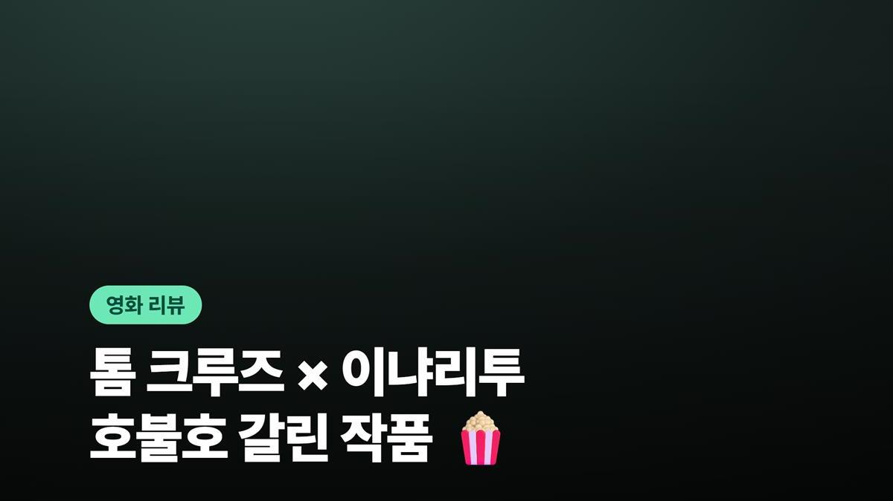
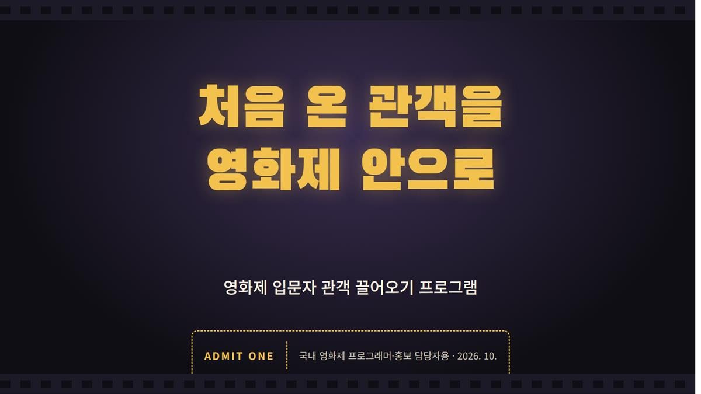
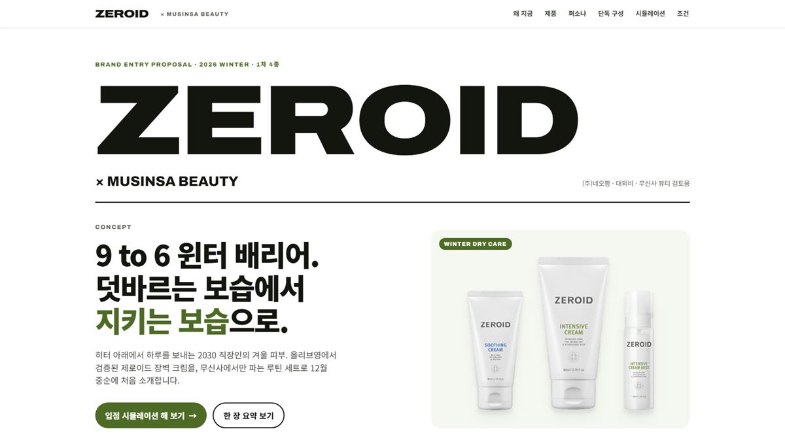
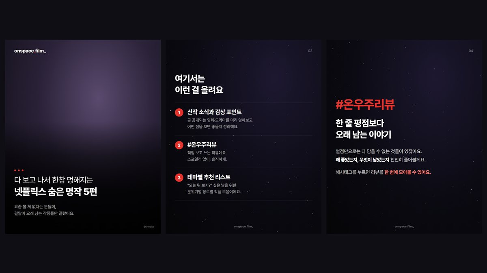
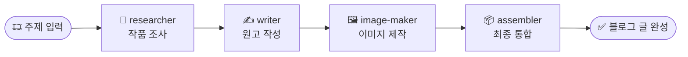
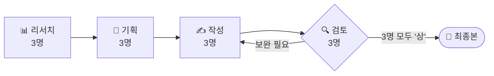
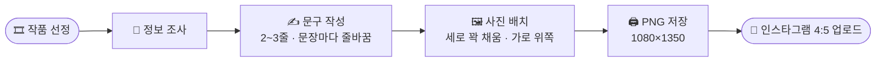

<div align="center">


<br>


</div>

<br>

## ✨ Projects

<table>
<tr>
<td width="50%" valign="top">

<a href="01_netflix-blog-automation/"></a>

### 🎬 넷플릭스 블로그 자동화
`콘텐츠 마케팅` `자동화`

주제 하나로 조사 → 원고 → 이미지 → 통합까지, **에이전트 4명**이 네이버 블로그 글을 완성합니다.

**[▶ 완성 글 보기](01_netflix-blog-automation/output/디거/final.md)**

</td>
<td width="50%" valign="top">

<a href="02_film-festival-newcomer-proposal/"></a>

### 🎟️ 영화제 입문자 관객 기획안
`프로그램 기획` `리서치`

**에이전트 12명**이 리서치·기획·검토를 v1 → v6 반복해 완성한 영화제 프로그램 기획안입니다.

**[▶ 최종 기획안 보기](02_film-festival-newcomer-proposal/05_최종/기획안_최종.md)**

</td>
</tr>
<tr>
<td width="50%" valign="top">

<a href="03_zeroid-musinsa-proposal/"></a>

### 🧴 제로이드 × 무신사 입점 제안
`브랜드 제안` `B2B 피칭`

제로이드의 무신사 뷰티 입점 제안서·요약본·웹 제안서·피칭 자료 일체 (v34).

**[▶ 제안서 PDF 보기](03_zeroid-musinsa-proposal/최종본/제로이드_무신사_입점제안서_최종_v34.pdf)**

</td>
<td width="50%" valign="top">

<a href="04_instagram-cardnews/"></a>

### 📱 인스타그램 영화 카드뉴스
`SNS 콘텐츠` `디자인 템플릿`

영화 소개 계정 **onspace.film_** 의 표지·소식·리뷰 카드를 문구와 사진만 바꿔 다시 쓰는 HTML 템플릿입니다.

**[▶ 템플릿 보기](04_instagram-cardnews/)**

</td>
</tr>
</table>

<br>

## 🎬 01. 넷플릭스 추천 블로그 자동화

> 작품명만 입력하면, 네이버 블로그에 바로 올릴 수 있는 리뷰 글이 완성됩니다.



| 📂 결과물 | 🧩 구성 요소 |
|---|---|
| 📝 [완성 글 — 디거 리뷰](01_netflix-blog-automation/output/디거/final.md) | 📘 [문체 · SEO · 이미지 가이드](01_netflix-blog-automation/guides/) |
| 🔎 [조사 자료](01_netflix-blog-automation/output/디거/research.md) | 🤖 [에이전트 정의](01_netflix-blog-automation/.claude/agents/) |
| 🖼️ [본문 이미지](01_netflix-blog-automation/output/디거/images/) | 🛠️ [자동화 스크립트](01_netflix-blog-automation/tools/) |

<br>

## 🎟️ 02. 영화제 입문자 관객 끌어오기 프로그램

> 영화제는 꽉 차는데, 처음 온 관객은 보이지 않는다 — 입문자를 영화제 안으로 끌어오는 프로그램.

<table>
<tr>
<td align="center" width="25%">🗺️<br><b>입문자 추천 코스</b><br><sub>하루 2편 · 4개 코스</sub></td>
<td align="center" width="25%">💺<br><b>첫 방문 좌석</b><br><sub>추첨 · 약 60~180석</sub></td>
<td align="center" width="25%">📖<br><b>첫 영화제 가이드</b><br><sub>예매부터 관람까지</sub></td>
<td align="center" width="25%">✅<br><b>체크인 · 설문</b><br><sub>D+30 만족도 측정</sub></td>
</tr>
</table>



| 단계 | 바로가기 |
|---|---|
| 📄 **최종 결과** | [최종 기획안](02_film-festival-newcomer-proposal/05_최종/기획안_최종.md) · [슬라이드 원본](02_film-festival-newcomer-proposal/06_슬라이드/project/slides/) |
| 🛤️ **작업 과정** | [리서치](02_film-festival-newcomer-proposal/01_리서치/) → [기획](02_film-festival-newcomer-proposal/02_기획/) → [초안](02_film-festival-newcomer-proposal/03_초안/) → [검토](02_film-festival-newcomer-proposal/04_검토/) |
| 📋 **프로젝트 정보** | [PLAN.md](02_film-festival-newcomer-proposal/PLAN.md) · [에이전트 12명](02_film-festival-newcomer-proposal/.claude/agents/) |

<br>

## 🧴 03. 제로이드 × 무신사 뷰티 입점 제안

> **9 to 6 윈터 배리어** — 덧바르는 보습에서 지키는 보습으로. <sub>(타깃: 2030 직장인)</sub>

<table>
<tr>
<td align="center" width="25%">🧠<br><b>WHY</b><br><sub>왜 무신사에, 왜 지금</sub></td>
<td align="center" width="25%">🎁<br><b>WHAT</b><br><sub>두 번 검증된 1차 4종</sub></td>
<td align="center" width="25%">🚀<br><b>HOW</b><br><sub>단독 세트 · 7주 일정</sub></td>
<td align="center" width="25%">📈<br><b>WHAT IF</b><br><sub>3개월 목표 · 사계절 확장</sub></td>
</tr>
</table>

| 📂 결과물 | 링크 |
|---|---|
| 📕 **입점제안서 상세본** | [PDF (v34)](03_zeroid-musinsa-proposal/최종본/제로이드_무신사_입점제안서_최종_v34.pdf) · [웹 버전](https://claude.ai/artifact/RSG2kEVWNrCkQSoCEuUesB) |
| 📗 **요약본** | [PDF (v34)](03_zeroid-musinsa-proposal/최종본/제로이드_무신사_입점제안서_요약본_최종_v34.pdf) |
| 🌐 **인터랙티브 웹 제안서** | [바로 보기](https://claude.ai/artifact/R61tRM4U6Zd29hccNGtuPy) |
| 🎤 **피칭 자료** | [3분 스크립트 · 예상 질문](03_zeroid-musinsa-proposal/meeting/피칭스크립트_예상질문.md) |
| 🔍 **검토 · 보강** | [무신사 MD 검토팀](03_zeroid-musinsa-proposal/review/무신사MD_검토팀.md) · [대응 전략](03_zeroid-musinsa-proposal/review/보강팀_대응전략.md) |

<details>
<summary>📁 더 보기 — 버전 기록 · 브랜드 정보</summary>

- [프로젝트 계획 (PLAN.md)](03_zeroid-musinsa-proposal/PLAN.md)
- [버전별 최종 PDF (v20 ~ v34)](03_zeroid-musinsa-proposal/최종본/)
- [버전별 HTML 스냅샷](03_zeroid-musinsa-proposal/versions/)
- [브랜드 정보](03_zeroid-musinsa-proposal/zeroid_brand_info.md)

</details>

<br>

## 📱 04. 인스타그램 영화 카드뉴스 템플릿

> 문구와 사진만 바꾸면, 인스타그램에 바로 올릴 4:5 카드뉴스가 완성됩니다.

<table>
<tr>
<td align="center" width="25%">👋<br><b>계정 소개</b><br><sub>5장 · 우주 배경</sub></td>
<td align="center" width="25%">📰<br><b>공개 소식</b><br><sub>7장 · 포스터 · 감상 포인트</sub></td>
<td align="center" width="25%">🌕<br><b>#온우주리뷰</b><br><sub>7장 · 별점 · 호불호</sub></td>
<td align="center" width="25%">🖨️<br><b>PNG 저장</b><br><sub>1080×1350 · Edge 헤드리스</sub></td>
</tr>
</table>



| 📂 템플릿 | 링크 |
|---|---|
| 🧱 **표지 기본 틀** | [template/cover.html](04_instagram-cardnews/template/cover.html) |
| 👋 **계정 소개** | [intro.html](04_instagram-cardnews/posts/00_account-intro/intro.html) · [캡션](04_instagram-cardnews/posts/00_account-intro/caption.txt) |
| 📰 **<가능한 사랑> 공개 소식** | [cover.html](04_instagram-cardnews/posts/01_possible-love_news/cover.html) · [cards.html](04_instagram-cardnews/posts/01_possible-love_news/cards.html) · [캡션](04_instagram-cardnews/posts/01_possible-love_news/caption.txt) |
| 🌕 **<가능한 사랑> #온우주리뷰** | [review.html](04_instagram-cardnews/posts/02_possible-love_review/review.html) · [캡션](04_instagram-cardnews/posts/02_possible-love_review/caption.txt) |
| 📘 **사용법** | [README — 디자인 규칙 · 사진 넣기 · PNG 저장](04_instagram-cardnews/README.md) |

<sub>※ 영화 스틸컷 · 포스터와 완성 카드 이미지는 저작권 때문에 저장소에 포함하지 않았습니다.</sub>

<br>

## 🗂️ Structure

```
📦 portfolio
 ┣ 📂 01_netflix-blog-automation          🎬 넷플릭스 추천 블로그 자동화
 ┣ 📂 02_film-festival-newcomer-proposal  🎟️ 영화제 입문자 관객 기획안
 ┣ 📂 03_zeroid-musinsa-proposal          🧴 제로이드 × 무신사 입점 제안
 ┣ 📂 04_instagram-cardnews               📱 인스타그램 영화 카드뉴스 템플릿
 ┗ 📂 assets                              🖼️ README 미리보기 이미지
```

<div align="center">


</div>
