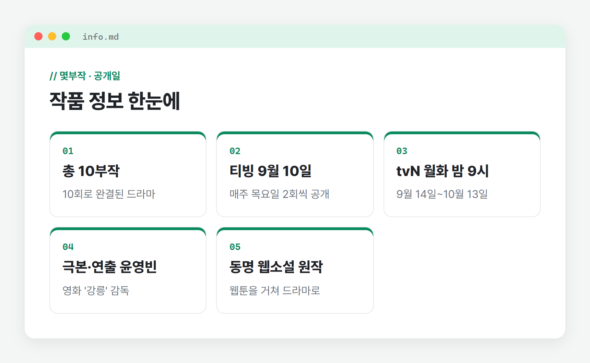
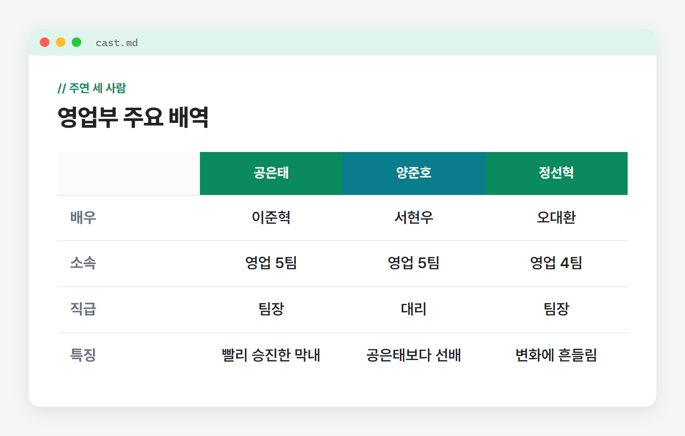
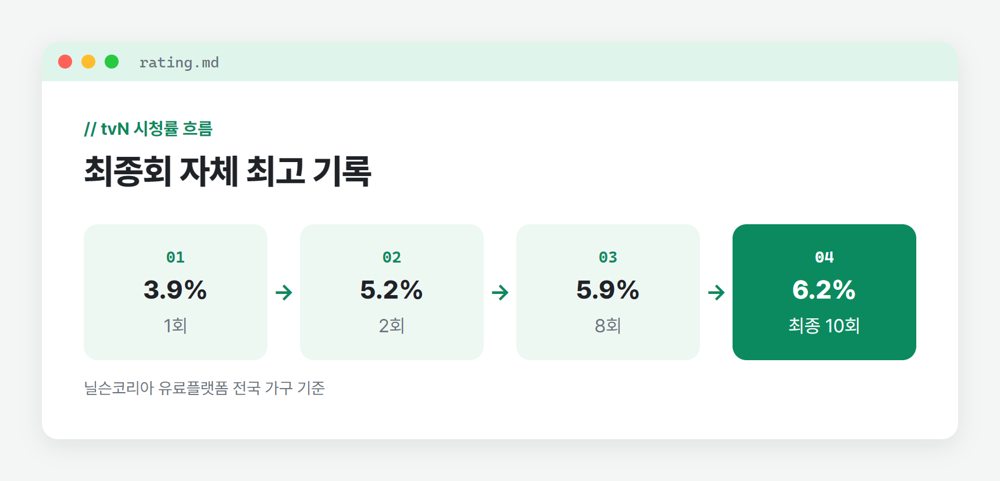

<!--
==================== 작성 메모 (발행 시 삭제) ====================
글 종류 : 단일 작품 리뷰 (티빙 오리지널 · tvN 방송 드라마, 사용자 결정에 따른 예외)
권장 발행일 : 2026-11-02 ~ 11-05 (종영 작품이라 적시성 기준 대신 가능한 한 빨리)
발행 주제 분류 : 드라마

[썸네일] 1080x1080, 글씨 화면 25% 이하, 라벨 + 2줄
  라벨 : 드라마 리뷰
  1줄 : 13억 당첨, 그래도 출근
  2줄 : 티빙 10부작 노스포 💼
  이미지 : 사원증 옆에 로또 용지가 놓인 공식 티저 포스터 (분할·잘림 금지, 인물·소품은 가운데 80% 안)
  파일 : images/thumbnail.png

[발행 전 꼭 할 일]
  1. ✍️ 표시 4곳을 직접 쓴 경험 문장으로 채우기
  2. 티빙 공식 페이지(또는 tvN 공식 페이지)에서 공개일·러닝타임·등급 재확인, 🚫 등급 칸과 출처 줄 확인 날짜 채우기
  3. [이미지: …] 자리에 티빙·tvN(CJ ENM) 공식 배포 스틸 넣기 (캡션 ⓒ TVING, 배포처 표기가 다르면 그 권리자로 수정)
  4. [내 글 링크] 자리에 관련 글 링크 넣기 (없으면 문장 삭제)
  5. 이미지 파일명·대체 텍스트는 "로또1등도출근합니다-장면.jpg" / "로또 1등도 출근합니다 [장면 설명]" 형식

[사용한 출처] (research.md 번호)
  [1] iMBC연예, 2026-08-12  https://enews.imbc.com/News/RetrieveNewsInfo/514534  - 티빙 선공개·tvN 첫 방송 일정, 윤영빈 극본·연출, 줄거리 설정, 티저 대사
  [2] 일간스포츠, 2026-08-12  https://isplus.com/article/view/isp202608120016  - 티저 포스터(사원증·로또 용지), 방송 시간
  [3] iMBC연예, 2026-09-08  https://enews.imbc.com/News/RetrieveNewsInfo/517533  - 제작발표회, 이준혁 "작품에 투자" 답변, 줄거리 설정
  [4] TV리포트, 2026-08-27  https://tvreport.co.kr/breaking/article/1071454/  - 웹소설→웹툰→드라마 각색, 오대환 배역
  [5] 위키트리, 2026-09-03  https://www.wikitree.co.kr/articles/1157015  - 양준호 캐릭터 설명, 주변 인물이 흔들리는 설정
  [8] 위키트리, 2026-10-14  https://www.wikitree.co.kr/articles/1166007  - 10부작, 최종회 6.2%, 결말 선공개 후 자체 최고, 이현균·하율리 배역
  [9] 텐아시아, 2026-10-07  https://www.tenasia.co.kr/article/2026100772644  - 1~8화 평균 완주율 약 81%, 8회 시청률
  [9b] 텐아시아, 2026-10-14  https://www.tenasia.co.kr/article/2026101408034  - 옥자연(진해주) 법무팀 소속
  [10] 엑스포츠뉴스, 2026-10-07  https://www.xportsnews.com/article/2204944  - 목요일 2회 공개, '돈이 생겨도 출근이 끝나는가' 관점
  [11] Soompi, 2026-08 무렵  https://www.soompi.com/article/1859842wpp/  - 공은태 영업 5팀 팀장, 서현우·오대환 배역
  [12] 위키트리, 2026-09-19  https://www.wikitree.co.kr/articles/1160639  - 1회 3.9%, 2회 5.2%
  [13] Soompi, 2026-09-09  https://www.soompi.com/article/1869226wpp/  - 이현균·백예인·박보경 배역
  [14] 리디북스, 2020-09-14  https://ridibooks.com/books/111144388  - 원작 웹소설 저자 서인하

[확인 필요]
  - 관람등급: research.md 「확인하지 못한 것」. 본문 🚫 칸은 비워 두었음(커뮤니티의 '15세' 언급은 쓰지 않음). 티빙·tvN 공식 페이지 확인 후 기입
  - 회차별 러닝타임: 소스 없음. ⏱️ 칸은 회차(10부작)만 씀
  - 원작 웹소설 작가: 서인하(리디북스·다수 기사) vs 서글픈사이코(TV리포트). 본문에는 판매처 표기인 '서인하'를 씀. 필명 관계 확인 필요, 불확실하면 작가명을 빼고 "동명 웹소설"로만 표기
  - 공은태 소속: 영업 5팀(다수·최신) vs 영업 1부(티저 포스터 설명). 본문은 '영업 5팀'
  - 옥자연 배역 직책: 법무팀 소속 vs 법무팀장. 본문은 '법무팀'으로만 표기
  - 홍진기(박기태 역): 원문 미확인이라 본문에서 뺌
  - 당첨금 세전 금액(19억 등): 원문 미확인이라 뺌. 본문은 '13억 원'만 씀
  - 해외 공개 플랫폼(디즈니+ 일본 1위, 비키 톱10 등): 사용자 지시(넷플릭스 등 타 플랫폼 시청 안내 지양)와 글 초점에 맞춰 본문에서 뺌
==================================================================
-->

# 로또 1등도 출근합니다 티빙 드라마 몇부작 출연진 노스포 후기

**tvN 월화드라마로 방송된 티빙 오리지널 「로또 1등도 출근합니다」를 리뷰합니다.**

월요일 아침마다 복권만 되면 그만둔다고 다짐해 본 직장인이라면 「로또 1등도 출근합니다」에 주목해야 됩니다. 영화 '강릉'의 윤영빈 감독이 극본과 연출을 함께 맡았고, 이준혁이 로또 1등에 당첨된 막내 팀장으로 나섭니다.

흔한 인생 역전 드라마가 아닙니다. 13억 원이 생긴 뒤에도 사직서 대신 사원증을 챙겨 출근하는 이야기로, 돈이 생겨도 회사 생활이 끝나는지를 묻는 작품이었죠.

이번 포스팅에서는 몇부작인지와 출연진, 줄거리 설정, 보기 전 알아두면 좋은 정보를 정리하고, 누구와 보면 좋을지까지 스포 없이 살펴보겠습니다.

🔒 스포 없어요

## 로또 1등도 출근합니다 몇부작? 공개일과 회차 정리
작품 정보와 포스터를 살펴봅니다.

[이미지: 창 프레임 / 사원증 옆에 로또 용지가 놓인 공식 티저 포스터]
사원증 옆에 로또 용지가 놓인 티저 포스터 ⓒ TVING

총 10부작입니다. 티빙에서 9월 10일 먼저 공개됐고, tvN에서는 9월 14일부터 10월 13일까지 월·화 밤 9시에 방송됐습니다.

🎬 : 윤영빈 (극본·연출)  
👫 : 이준혁, 서현우, 오대환  

📍 : 오피스, 드라마  
⏱️ : 10부작  
🚫 : [확인 후 기입]  
📅 : 2026년 9월 10일 티빙 공개, 9월 14일 tvN 첫 방송  

출처: iMBC연예(2026-08-12·09-08), 일간스포츠(08-12), 위키트리(09-03·09-19·10-14), 텐아시아(10-07·10-14), Soompi(09-09), 리디북스 / 티빙 공식 페이지 __월 __일 확인

티빙은 매주 목요일 오후 6시에 2회씩 공개해 10월 8일 마지막 9·10회를 선보였습니다. 원작은 서인하 작가의 동명 웹소설이며, 웹툰으로 먼저 각색된 뒤 드라마가 됐습니다.

로또 1등도 출근합니다 작품 정보 한눈에

## 출연진은 누가 나올까? 주요 배역 정리
등장인물을 살펴봅니다.

영업부 사무실을 무대로 이야기에 힘을 보태는 출연진을 알아봅니다. 주연은 이준혁, 서현우, 오대환 세 사람입니다.

1️⃣ 이준혁 (공은태 역)

[이미지: 창 프레임 / 사원증을 건 공은태가 사무실에 서 있는 공식 스틸]
영업 5팀 팀장 공은태 ⓒ TVING

홍성인터내셔널 영업 5팀 팀장 공은태를 맡았습니다. 빨리 승진한 탓에 위로는 상사, 아래로는 선배 팀원에게 치이는 막내 팀장입니다.

제작발표회에서는 실제로 로또에 당첨되면 작품에 투자하고 싶다고 답해 눈길을 끌었습니다.

✍️ [직접 작성: 당첨 전후로 공은태의 표정·말투가 어떻게 달라 보였는지 스포 없이 1~2문장]

2️⃣ 서현우 (양준호 역)

영업 5팀 대리 양준호입니다. 공은태보다 선배지만 직급은 낮은 인물로, '트러블 메이커'로 소개됐습니다.

두 사람이 부딪히다 든든한 동료가 되어 가는 흐름이 관계의 축입니다. 선후배와 직급이 엇갈린 미묘한 공기를 따라가 보면 좋습니다.

3️⃣ 오대환 (정선혁 역)

영업 4팀 팀장 정선혁을 연기합니다. 공은태의 변화에 흔들리는 주변 인물 가운데 한 명입니다.

이 밖에 이현균(장경철 차장), 옥자연(법무팀 진해주), 하율리(계약직 사원 이지혜), 백예인(장향은), 박보경(박현숙 부장)이 영업부 안팎을 채웁니다.

영업부 주요 배역

## 줄거리
어떤 이야기인지 살펴봅니다.

[이미지: 창 프레임 / 영업 5팀 팀원들이 사무실에 함께 모인 공식 스틸]
영업 5팀이 모인 사무실 ⓒ TVING

위아래로 치이며 하루를 버티던 공은태가 어느 날 로또 1등에 당첨됩니다. 그는 회사를 그만두는 대신 13억 원을 마음에 품고 다시 출근합니다.

여유가 생기자 그동안 눈에 들어오지 않던 일과 사람이 보이기 시작합니다. 티저 예고편에서 회사를 한번 뒤집어 보겠다고 말하듯, 그의 출근길은 전과 달라집니다.

그 변화는 양준호와 정선혁 같은 주변 사람들까지 흔들어 놓습니다.

## 관람 포인트
눈여겨볼 장면을 정리합니다.

[이미지: 창 프레임 / 공은태와 양준호가 사무실에서 마주한 공식 스틸]
마주한 공은태와 양준호 ⓒ TVING

첫 번째는 '퇴사 대신 출근'이라는 뒤집힌 상상입니다. 돈 걱정에서 벗어난 사람이 회사에서 무엇을 다르게 보는지, 공은태의 시선을 따라가며 보면 익숙한 직장 이야기가 새롭게 읽힙니다.

두 번째는 숫자로 확인된 입소문입니다. tvN 시청률은 1회 3.9%로 출발해 최종회 6.2%로 자체 최고를 기록했습니다(닐슨코리아 유료플랫폼 전국 가구 기준).

티빙에서 결말이 먼저 공개된 뒤에도 최종회 수치가 올랐다는 점이 눈에 띕니다. 티빙의 1~8화 평균 완주율도 약 81%로 집계됐거든요.

tvN 시청률 흐름

✍️ [직접 작성: 내 회사 생활이 떠올라 공감했던 장면이나 대사를 결말 없이 1~2문장]

## 👥 누구와 보면 좋을까?
함께 보기 좋은 사람과 상황을 정리합니다.

👥 : 혼자 퇴근 후 한두 편씩 보기 좋습니다. 하루 업무를 마치고 보면 공은태의 출근길이 남의 일 같지 않게 다가옵니다.

👥 : 직장 동료나 친구와 주말 몰아보기로 보기 좋습니다. "나라면 그래도 출근할까"라는 질문 하나로 대화가 길게 이어집니다.

관람등급은 아직 공식 출처로 확인하지 못했습니다. 아이와 함께 볼 생각이라면 티빙에서 등급을 먼저 확인하시고, 회사 안 관계와 갈등이 중심이라 어린아이에게는 공감대가 적을 수 있다는 점도 참고하시기 바랍니다.

## 후기
보고 난 뒤 감상을 남깁니다.

✍️ [직접 작성: 전체를 본 뒤 한 줄 총평과 가장 좋았던 점, 아쉬웠던 점을 스포 없이 2~3문장]

✍️ [직접 작성: 몰아보기·한 주 2회씩 보기 중 어떤 방식으로 봤는지, 그 방식이 잘 맞았는지 1문장]

「로또 1등도 출근합니다」는 돈보다 일하는 이유를 다시 묻는 오피스 드라마입니다. 직장 생활에 지친 분, 사람 사이 관계가 조금씩 바뀌는 이야기를 좋아하는 분께 권합니다.

비슷한 결의 직장 드라마가 궁금하다면 [내 글 링크]도 함께 참고해 보세요.

#로또1등도출근합니다 #티빙 #티빙오리지널 #tvN드라마 #오피스드라마 #이준혁 #서현우 #퇴근후드라마
